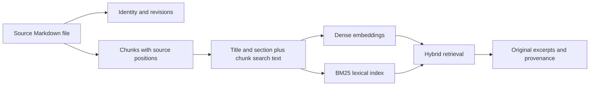
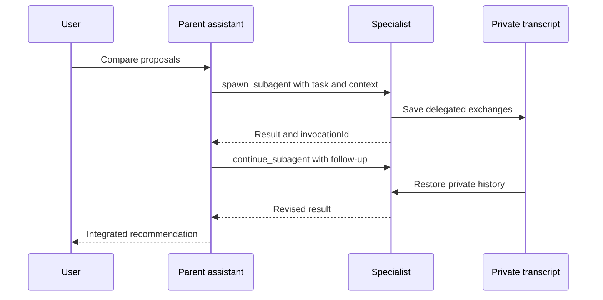
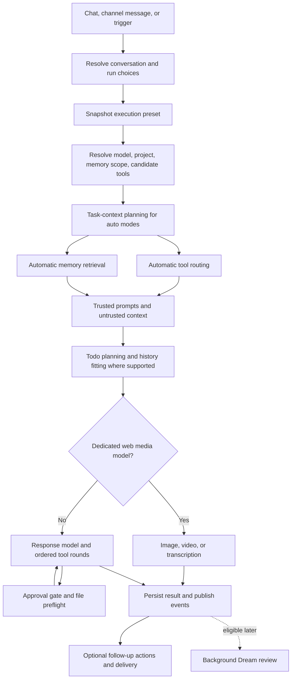

# Cyno: user and developer manual

Cynosure is the application and repository name. **Cyno** is its default assistant and the name used here for the everyday assistant experience.

This manual describes the checked-out implementation, whose root, server, web, and desktop packages all report **1.0.1**. It was checked against source on **25 October 2026**. Package version alone does not identify an exact feature set: this checkout includes changes beyond the older changelog entry. Provider capability statements describe implemented paths, not a guarantee that every external model supports them.

## Table of contents

1. [What Cynosure is](#1-what-cynosure-is)
2. [Getting started](#2-getting-started)
3. [Finding your way around](#3-finding-your-way-around)
4. [Chats, Free Chat, and Cyno](#4-chats-free-chat-and-cyno)
5. [Agents](#5-agents)
6. [Projects](#6-projects)
7. [Memory folders and the knowledge base](#7-memory-folders-and-the-knowledge-base)
8. [Tools and MCP](#8-tools-and-mcp)
9. [Permissions and approvals](#9-permissions-and-approvals)
10. [Sub-agents](#10-sub-agents)
11. [Scheduled jobs and waiting](#11-scheduled-jobs-and-waiting)
12. [Messaging channels](#12-messaging-channels)
13. [Images, video, audio, and documents](#13-images-video-audio-and-documents)
14. [Model providers](#14-model-providers)
15. [How a turn runs](#15-how-a-turn-runs)
16. [Context limits and compaction](#16-context-limits-and-compaction)
17. [Capabilities at a glance](#17-capabilities-at-a-glance)
18. [Practical workflows](#18-practical-workflows)
19. [Configuration and data](#19-configuration-and-data)
20. [Developer reference](#20-developer-reference)
21. [Desktop operation and updates](#21-desktop-operation-and-updates)
22. [Troubleshooting](#22-troubleshooting)
23. [Frequently asked questions](#23-frequently-asked-questions)
24. [Glossary](#24-glossary)
25. [Verification notes and source inventory](#25-verification-notes-and-source-inventory)

## 1. What Cynosure is

Cynosure is a personal AI workspace combining conversations, reusable agents, tools, projects, and lasting memory. It provides the interface and orchestration around model services that you configure yourself. You bring your own provider credentials or connect a local model server.

You can run the Vue web interface with the local Fastify server, or use the Electron desktop wrapper that bundles the interface and server. The code is open source under the GNU Affero General Public License, version 3 (**AGPL-3.0**); see [LICENSE.md](../LICENSE.md).

A local installation stores its workspace data on the server host. Model requests still go to the provider you select. Remote MCP servers and messaging platforms also receive the data needed for their operations. Local Whisper recording transcription is a separate browser-side option.

| Need | Building block |
| --- | --- |
| Ask a question or keep an exchange | A chat |
| Start with the default personal assistant | Cyno |
| Reuse instructions, tools, model choices, and memory access | An agent |
| Keep several chats aligned on a body of work | A project |
| Preserve information beyond any one conversation | Memory files and folders |
| Read files, run commands, or interact with services | Tools |
| Delegate a bounded piece of work | A sub-agent |
| Run work later or repeatedly | A scheduled job |
| Talk from Telegram, Discord, or Slack | A messaging channel |

## 2. Getting started

### 2.1 Requirements

For source development, use **Node.js 22 or newer** and **pnpm 12**. The root package declares `pnpm@12.6.0`; the server declares Node `>=22`. You need access to at least one model provider or a running local model server to obtain responses.

The repository does not specify a universal RAM, GPU, or disk requirement. Local model requirements belong to the runtime and model you choose. Adding an Ollama, LM Studio, or Unsloth connection does not launch that runtime for you.

### 2.2 Start the web application

From the repository root, on an installation that needs dependencies:

```bash
corepack enable pnpm
pnpm install
pnpm dev
```

If dependencies are already installed, `pnpm dev` is the startup command. It starts the server and web development processes together.

| Address | Purpose |
| --- | --- |
| `http://localhost:5173` | Web development interface |
| `http://localhost:3099` | Server; serves the built interface if available, otherwise server information |
| `http://localhost:3099/api/health` | Server health and version |
| `http://localhost:3099/docs` | Swagger API documentation |
| `ws://localhost:3099/ws` | WebSocket events and interaction transport |

These are defaults. Vite proxies `/api` and `/ws` to the server. A custom server port also requires the web proxy configuration to point at it; see [configuration](#19-configuration-and-data).

### 2.3 Connect a provider

On first use, the web router opens the setup guide. Its steps include **Profile**, **AI Provider**, **Memory**, **MCP Tools**, and **First Agent**. Memory, additional tools, and specialist agents can be configured later.

To add or change providers after setup, open **Settings → Providers**:

1. Choose the provider type and enter a display name.
2. Enter an API key when required. Ollama and LM Studio are the two types whose server validation permits no key. Unsloth requires a key.
3. For a local provider, confirm its **Server base URL**. The form only exposes editable base URLs for local provider types.
4. Load the model list and choose a default model, or enter its model name if listing fails or returns no models.
5. Save the provider. Use its connection test when diagnosing access problems.

Saving constructs and registers a provider client; it does not prove that a generation request will succeed. Model access, credentials, the selected model, and a local runtime's availability still matter.

### 2.4 Send the first message

Open `/chat`, choose Cyno or an agent, and confirm the provider/model selection. Send a simple request such as:

> Help me plan tomorrow. Ask for any information you need, then make a short checklist.

You do not need to create a specialist agent first. Start with **Auto** permissions unless you have a reason to choose another mode. Add memory and tool integrations when the task calls for them.

### 2.5 Start the desktop development app

```bash
pnpm dev:electron
```

This starts the web development server on **5180** and Electron, which starts its own server. Restart Electron to load server-side changes; web changes hot-reload. Run this as a separate startup mode from `pnpm dev`.

The desktop prefers server port **3099** and selects a free local port if it is occupied. Its renderer learns that port through preload. It shares the normal Cynosure data location unless overridden.

Sources: [root scripts](../package.json), [server startup](../apps/server/src/index.ts), [web development configuration](../apps/web/vite.config.ts), [provider validation](../apps/server/src/routes/providers.ts), [provider form](../apps/web/src/components/settings/ProviderForm.vue), [desktop scripts](../apps/electron/package.json).

## 3. Finding your way around

The router provides these main destinations. Navigation presentation can vary with screen size.

| Destination | What it contains |
| --- | --- |
| Chat, `/chat` | New and existing conversations |
| Agents, `/agents` | Specialist agents and the default Cyno profile |
| Projects, `/projects` | Project workspaces |
| Memory, `/memory-folders/documents` | Memory documents and folder organization |
| Library, `/library/generated` and `/library/uploads` | Generated files and reusable uploads |
| Scheduled jobs, `/cron` | Recurring jobs, one-off jobs, and waits |
| Activity, `/activity` | Active work and histories including chat, cron, memory, and Dream |
| Tool policy, `/tools-policy` | Per-tool approval behavior |
| Notifications, `/notifications` | App notifications and read/dismiss controls |
| Usage, `/usage` | Usage reporting |
| Settings, `/settings` | Profile, appearance, providers, memory, chat, voice, channels, file access, backup, reset, and About |
| MCP settings, `/settings/mcp` | MCP server configuration and discovery |

Settings supports search. Some settings save as a group and warn about unsaved changes when you leave; use the page's save controls where present.

Older `/artifacts` bookmarks redirect to Library. Former relationship and visual-graph memory URLs redirect to documents; those graph views are no longer current features.

Source: [web router](../apps/web/src/router/index.ts), [settings view](../apps/web/src/views/settings/SettingsView.vue), and the views in the [source inventory](#25-verification-notes-and-source-inventory).

## 4. Chats, Free Chat, and Cyno

### 4.1 A conversation is the durable workspace for a turn

A conversation stores messages, attachments, tool activity, its project association, and its execution settings. A chat can use a specialist agent or run without an agent ID. Older documentation calls the latter **Free Chat**; the current default assistant experience is **Cyno**.

Use a chat for an ongoing question or task. Start a new one when earlier exchanges are no longer useful. The implementation supports conversation search, pinning, renaming, and forking history through a selected message. Editing or retrying messages can change subsequent history, so preserve a branch with a fork when you want to retain alternatives.

### 4.2 Cyno's profile

Open Cyno's entry in Agents, or `/agents/cyno`, to edit the default assistant using the agent editor. Its profile is stored in the server's settings table and survives a browser storage reset.

The profile includes name and icon, system prompt, provider/model, selected tools, memory folders, assigned sub-agents, thinking/reasoning choices, automatic tool routing, automatic memory, and Dream eligibility.

Factory values enable thinking, automatic tools, automatic memory, and Dream eligibility, with reasoning effort `medium`. Provider/model are initially unset. Unset memory resolves to the root **All Memory** selection. Unset tools resolve to MCP management and the five scheduling tools; automatic routing can discover other available capabilities.

Cyno's Advanced editor does not expose the specialist agent's blanket tool approval, routing-model override, or maximum-context controls.

### 4.3 Chat settings and reusable settings

An agent or Cyno profile supplies the starting configuration. The web client keeps session choices and sends them with each turn. The server resolves them into a per-execution snapshot and saves the effective configuration, including resolved provider/model, on the conversation.

Changing an agent definition does not rewrite every existing conversation's saved configuration. You can keep changes in a chat, reset overrides, or apply supported overrides back to the reusable agent/profile. Check current chat choices when an older conversation behaves differently from a new one.

The snapshot covers execution choices; it is not a frozen copy of every workspace setting. Permissions, project state, available tools, and other runtime policies can still be resolved during execution.

### 4.4 Composer commands

Type `/` in the web composer to discover commands and arguments.

| Command | Use |
| --- | --- |
| `/new` (`/clear`) | Start a new chat |
| `/stop` | Stop the current response |
| `/compact` | Summarize the existing chat for future context |
| `/pin`, `/unpin` | Toggle pinning |
| `/rename` | Set the title |
| `/goal <objective>` | Start work tracked by a goal todo list |
| `/attach`, `/upload` | Attach a file from your device |
| `/library` | Reuse an upload |
| `/model` | Choose provider/model |
| `/think` (`/reasoning`, `/effort`) | Choose reasoning behavior |
| `/auto-memory`, `/auto-tools` | Toggle automatic routing modes |
| `/tools` (`/mcp`) | Change selected tools/tool groups |
| `/memory` (`/memories`) | Change memory folder selection |
| `/agent` (`/subagent`) | Toggle a sub-agent assignment for the session |
| `/project` | Associate the chat with a project or leave it |
| `/system` (`/prompt`) | Edit the session system prompt |
| `/reset` | Reset supported session settings |
| `/settings` | Open settings |

These are composer actions, not a guarantee that identical commands exist on messaging platforms. Web `/agent` manages delegated agents; channel commands named after agents switch the assistant for that target.

A `/goal` run needs a tool-capable model. Its todo list constrains when the executor considers work finished, while round limits and cancellation still apply.

### 4.5 Incognito and queued messages

Incognito uses a **temporary conversation**, not an exclusively in-memory transport. The server stores it while it is in use; discard removes it and startup purges abandoned temporary conversations. Saving it makes it a normal conversation. Scheduling tools are unavailable until it is saved, and Dream excludes temporary chats.

The composer can queue messages during work. Queue records survive server restart, but restart pauses them for explicit resumption. Stop and queue controls should be checked when a conversation appears idle with messages still waiting. A pending `schedule_wait` also affects when a new message executes.

Sources: [Cyno profile](../apps/server/src/core/cyno/cyno-profile.ts), [effective defaults](../apps/server/src/core/cyno/cyno-run.ts), [conversation routes](../apps/server/src/routes/conversations.ts), [chat configuration](../apps/web/src/composables/useChatAgentConfig.ts), [composer commands](../apps/web/src/composables/useSlashCommands.ts), [chat routes](../apps/server/src/routes/chat.ts).

## 5. Agents

An agent is a reusable configuration for a kind of work. Use one when instructions, model choice, tool access, or memory scope should be consistent across repeated tasks.

### 5.1 Create and configure an agent

Create an agent in Agents, then open its detail editor. Its sections are **General**, **Tools**, **Memory**, **Sub-Agents**, and **Advanced**.

| Configuration | Why it matters |
| --- | --- |
| Name, description, category, icon | Identify the role in lists and chats |
| Internal name | Role name used for sub-agent selection and channel commands |
| System prompt | Standing instructions and constraints |
| Provider and model | Model used unless a run overrides it |
| Thinking and reasoning effort | Passed through the provider adapter where supported |
| Tools and automatic routing | Pin tools or let routing select relevant capabilities |
| Memory folders and automatic memory | Available knowledge and automatic retrieval behavior |
| Sub-agents | Other agents this one may delegate to |
| Auto-Approve All Tools | Bypass the normal per-tool HITL gate for this agent's execution |
| Context Routing Model | Override the auxiliary automatic-context model |
| Max Context Tokens | Cap effective context in the app chat path |
| Dream eligibility | Permit background review when Dream is globally configured |

Save the definition before starting a new chat from it. The list supports duplication, favorites, and deletion.

For example, a release-review agent might use:

> Review release proposals. Identify contradictions, missing dependencies, and decisions needing an owner. Cite the supplied material. Ask before using tools that change external state.

Prompts can use smart tags resolved for the run, including Cyno's `{{currentDate}}` and `{{selectedMemFolderNames}}`. A prompt does not itself grant tools or folders.

### 5.2 Important boundaries

Selected tools are stored as stable registry keys, not ambiguous bare names. Missing keys are dropped during normalization. Check agent warnings after removing an MCP server.

An agent with no assigned memory folders has an explicit empty memory scope. Automatic memory does not create access to an unassigned folder.

With automatic tools enabled, a small manual selection pins tools and does not necessarily restrict discovery to them. For a static selection, disable automatic routing. More than **50** manually selected tools activates routing within that selected catalog to limit prompt size.

Blanket agent auto-approval is distinct from chat permission mode, global per-tool policy, and native file-folder authorization. See [permissions](#9-permissions-and-approvals).

Implementation caveat: run settings carry an agent context cap, but the cron trigger runner does not pass a context window into its executor. Do not assume the app chat's Max Context Tokens behavior applies identically to scheduled runs.

Sources: [agent store](../apps/server/src/core/agents/agent-store.ts), [editor](../apps/web/src/views/AgentDetailView.vue), [advanced controls](../apps/web/src/components/agent/AgentAdvancedTab.vue), [planner](../apps/server/src/core/agent/pre-execution/execution-planner.ts), [trigger runner](../apps/server/src/core/triggers/trigger-runner.ts).

## 6. Projects

A project says **what the work is and where it lives**. An agent says **who does it and how**. Any agent, including Cyno without a specialist agent ID, can work inside a project.

### 6.1 Set up a project

Create a project under Projects. Give it a name and description, then configure instructions and, if needed, an existing server-host directory. The detail view provides **Overview**, **Board**, **Chats**, **Memories**, **Timeline**, and **Settings**; **Folder** appears when a root directory is configured.

A project normally creates memory under `Projects/<name>`. The store also supports selecting an existing folder or skipping creation. Conversations and scheduled jobs retain their project ID.

The root is an existing absolute directory, validated and canonicalized on the server. It is not the browser device's filesystem unless browser and server run on the same machine.

### 6.2 Four forms of project context

| Context | How it is used |
| --- | --- |
| Instructions | User-authored guidance appended to the system prompt |
| Brief | Shared account of goal, state, decisions, and next steps |
| Task board | Work that should survive a particular chat |
| Memory folder | Durable reference knowledge retrieved when relevant |

The brief and open tasks enter each run as lower-authority, untrusted project-state data. They help interpret work without turning agent-written text into system instructions.

An agent-written brief must contain **Goal**, **State**, **Decisions**, and **Next** headings and is limited to **6,000 characters**. Updates replace the whole brief. Concurrent changes are checked: a stale writer receives the current brief for merging instead of silently overwriting it.

Tasks use `todo`, `in_progress`, `blocked`, and `done`. Initial context includes up to **15** open tasks, prioritizing in-progress and blocked work; tools can list the rest. Setting task status can link the current run's todo plan into its work log. Tasks can hold supporting attachments; project history and brief revisions support later review.

### 6.3 What a project adds to a run

The server automatically adds `project_brief_update`, `project_task_list`, `project_task_create`, and `project_task_update`. These tools are system auto-approved, including in Read Only mode.

Cyno receives project-lead guidance to maintain the brief/board and pick up important open work when asked to continue. Specialists receive common project context for their part of the work.

Project memory merges into the run's scope, except when the chat explicitly selects no folders. Sub-agents share the parent conversation ID and inherit project context.

Native file tools may access the project root within that conversation's execution scope. Shell defaults to that directory. This project grant does not authorize unrelated conversations or constrain a shell process to the directory.

### 6.4 Archive or delete

Archiving removes a project from normal available-project lists and channel suggestions. Deleting it unassigns its conversations/jobs and preserves its memory folder. Tasks and project history belong to the deleted project; unused task attachment files are removed, while files already used in chats are preserved according to the store's cleanup policy.

Sources: [store](../apps/server/src/core/projects/project-store.ts), [run context](../apps/server/src/core/projects/project-context.ts), [tools](../apps/server/src/core/projects/project-tools.ts), [project view](../apps/web/src/views/ProjectDetailView.vue), [routes](../apps/server/src/routes/projects.ts).

## 7. Memory folders and the knowledge base

Memory is information intended to outlive a chat. Use it for personal notes, project decisions, recurring procedures, people, and reference material.

### 7.1 Files are authoritative

Memory folders correspond to directories under the memory root. **Saved Markdown files are the source of truth.** SQLite tracks identity, revisions, and indexing state; LanceDB holds rebuildable retrieval data. A chunk is evidence from a file, not a separate canonical note.

The file manager also accepts `.txt`, PDF, DOCX, PPTX, XLSX, ODT, ODP, ODS, and RTF. Document conversion produces structured Markdown for indexing. Conversion quality depends on the source; the code does not establish a general scanned-document OCR guarantee.

A folder watcher observes changes and manages indexing. You can organize/edit source files outside the UI, but inspect indexing state afterward. The UI exposes content, revision history, differences, restoration, reindexing, and indexing jobs/failures.



### 7.2 Configure retrieval and choose scope

1. Open **Settings → Memory** and configure an embedding provider/model.
2. Create folders and import or write notes in Memory.
3. Wait for indexing and inspect reported failures.
4. Select relevant folders in the agent or chat.
5. Enable automatic memory for pre-response retrieval, or use memory tools during a tool-capable run.

A parent selection includes registered descendants. The root selection is **All Memory**, while uncategorized files live at the memory root. A folder can be made **opt-in**, excluding it from All Memory; explicit selection of it or an applicable non-root parent grants it normally.

Memory settings separately configure embeddings, reranking/curation, and Dream. When reranking is off, automatic retrieval uses a configured curation model or the conversation model. Saving an embedding change probes dimensions and can offer **Re-Embed All Memories** or **Drop & Save**. Re-embedding stages and verifies a replacement index before activation; dropping removes derived vectors, not the canonical source files, which can be reindexed.

An explicit empty folder selection suppresses turn-time automatic retrieval and runtime memory tools, including automatic addition of project memory. Turning off automatic memory alone is different: selected folders can still make runtime memory tools available.

### 7.3 Search and maintenance

Current file search supports names/folder paths and a semantic content mode backed by embeddings. It no longer searches removed analysis tags or summaries described in the old changelog.

`memory_search` retrieves scoped knowledge; `memory_create`, `memory_patch`, and `memory_delete` maintain canonical files. Memory tools are added according to memory availability rather than treated as ordinary manually selected tools. Mutation approvals follow applicable policy.

Use clear titles and headings. Ask the assistant to search before creating, update matching files instead of duplicating facts, and preserve provenance through revisions. Removing an index and deleting a document are different: indexes can be rebuilt; source deletion changes the knowledge base.

### 7.4 Dream Mode: background memory review

Dream is a separate background curator. Configure its provider/model in **Settings → Memory** and enable eligibility for Cyno or the agent. No configured Dream provider means Dream is off, even when an assistant's eligibility flag is on.

The worker checks roughly once per minute and considers inactive, non-temporary **chat and channel** conversations after **five minutes** of inactivity. Its eligibility window begins when configured; it does not simply sweep all historic messages. Cron-origin conversations are not selected by the current sweep query.

Dream reviews enduring facts, preferences, decisions, corrections, and reusable lessons. It searches before writing, can create/patch/delete memory, records changes, and may make no changes. In projects it prioritizes project memory and can update the brief. Activity exposes Dream runs and cancellation.

Its prompt asks it to omit secrets and unsupported claims; review the actual changes. Dream uses its own scoped executor rather than a user-facing approval for each mutation.

**Memory-off distinction:** Dream's scope resolver falls back to assigned/default folders when the saved selection is empty. Selecting no folders for turn-time retrieval therefore does not disable Dream. Disable that assistant's eligibility or clear the global Dream provider to prevent these reviews. Read Only likewise describes the interactive tool run, not a switch that disables Dream.

Sources: [file manager](../apps/server/src/core/memory/memory-file-manager.ts), [folder scope](../apps/server/src/core/memory/memory-folder-scope.ts), [routes](../apps/server/src/routes/memory-folders.ts), [memory preparation](../apps/server/src/core/agent/pre-execution/execution-memory.ts), [Dream worker](../apps/server/src/core/memory/dream-worker.ts).

## 8. Tools and MCP

A tool is a callable capability available to the assistant. Availability, automatic discovery, and approval are separate decisions.

### 8.1 Built-in tools

| Group | Implemented capabilities |
| --- | --- |
| Memory | Search, create, patch, delete memory files |
| Scheduling | Create/list/update/delete jobs; pause a conversation with `schedule_wait` |
| Files | Metadata, directory listing/tree, path search, content grep, text/media reads, write/edit, create directories, move, merge directories, ZIP archives, delete |
| Shell | `shell_execute` runs a command on the server host |
| Notifications | `notify_user` creates an app notification or uses a connected channel |
| MCP management | `manage_mcp` manages configured MCP connections |
| Execution helpers | Todo planning, attachment search/read, MCP discovery, and sub-agent spawn/continue are added when relevant |
| Projects | Brief/task tools are added inside a project |

Native file tools include `file_read`, `file_grep`, `file_write`, and `file_edit`. Edits use exact matches and support a dry run. File tools enforce allowed folders. A folder grant is shared server configuration; use **Settings → File Access** to review/remove saved grants.

`shell_execute` runs with the permissions and environment of the server process. It is not limited by the native file-tool folder allowlist. Its default timeout is **120 seconds**, maximum requested timeout **600 seconds**, and collected output cap **128 KiB**. A guard refuses recognized destructive system commands, but it is not an operating-system sandbox.

### 8.2 MCP servers

Model Context Protocol connects external tool providers. Open MCP settings to configure a server or browse available entries. Transports include:

- **stdio:** local command, arguments, and environment variables.
- **Streamable HTTP:** remote endpoint.
- **SSE:** remote event-stream endpoint.

A local command and runtime must exist on the server machine. Electron does not bundle your MCP servers. Remote configuration supports headers and OAuth where applicable. The form stores remote header values in the environment map instead of putting secrets directly in displayed command arguments.

The manager expands `${VAR}` and `${VAR:-default}` references using configured/server environment values. It supports reconnecting and reauthorization. Connected tools enter the registry; disabling/disconnecting a server changes the available catalog.

### 8.3 Namespaces and routing

A namespace identifies a capability group, such as `builtin:files` or `mcp:<serverId>`. Stable keys have this shape:

```text
namespaceId::toolName
builtin:files::file_read
```

The registry retains original and provider-safe execution names and resolves collisions. Persist registry keys in integrations instead of guessing callable names.

Automatic routing narrows capabilities sent to the response model. Selected tools are pinned, and recent/used tools can survive selection. `expand_available_toolset` lets the assistant discover additional MCP capabilities from its available catalog. Discovery does not connect arbitrary services or approve actions.

Sources: [built-ins](../apps/server/src/core/tools/built-in-tools.ts), [file tools](../apps/server/src/core/tools/builtin/file-tools.ts), [shell](../apps/server/src/core/tools/builtin/shell-tool.ts), [registry](../apps/server/src/core/tools/tool-registry.ts), [MCP manager](../apps/server/src/core/tools/mcp/mcp-manager.ts).

## 9. Permissions and approvals

### 9.1 Chat permission modes

Choose a mode from the composer permission selector:

| UI label | API value | Behavior |
| --- | --- | --- |
| Read Only | `read-only` | Offers read-only tools and defined internal/project exceptions; an active HITL gate rejects other calls |
| Auto | `auto` | Uses system rules, saved per-tool choices, annotations, and session approvals |
| Full Access | `full` | Bypasses the normal tool approval gate for the conversation |

**Read Only has deliberate exceptions.** Internal planning, retrieval, attachment reads, discovery, sub-agent delegation, and project brief/task updates remain available. Project tools can therefore change the brief and board. Sub-agents share the parent conversation mode.

A run without a saved mode defaults to Auto. Permissions regulate tools, not the correctness of an answer.

### 9.2 Human-in-the-loop (HITL)

When approval is needed, execution pauses and presents the requested action. The web dialog supports **Allow**, **Deny Request**, an optional denial reason, **Allow in this Session**, and **Allow All Tools in this Session**. The all-tools option changes the conversation to Full Access through the server approval handler. Channels offer platform-specific approve/deny buttons.

For normal Auto mode, the gate applies these rules:

1. Internal and project tools are system auto-approved.
2. An explicit per-tool choice takes precedence over annotation defaults.
3. `readOnlyHint: true` is allowed by default unless `destructiveHint: true` conflicts.
4. Other tools need approval unless already approved for the conversation.

Tool Policy offers **Allow**, **Ask**, and **Default**. Session approvals are persisted against the conversation and survive page reload; “session” does not mean only the current browser tab.

An agent's **Auto-Approve All Tools** disables its normal HITL gate. Consider it when a run does not ask despite an Ask policy. Read Only still filters tools prepared for the run.

### 9.3 Folder permission is separate

A native file operation outside effective allowed roots requests folder access. **Allow folder and run** adds the folder to File Access and permits that invocation. Project roots also grant access during their conversations.

Full Access and agent auto-approval do not populate the folder allowlist. File preflight can still ask for a grant. These checks apply to native file tools; shell commands and external MCPs have their own access behavior.

Pending approvals have no surviving executor after restart and are cleared at database startup. Restarting work requires a new execution rather than answering an old prompt.

Sources: [selector](../apps/web/src/components/chat/inputbar/PermissionModeSelect.vue), [policy](../apps/server/src/core/tools/tool-policy.ts), [HITL gate](../apps/server/src/core/agent/hitl-gate.ts), [dialog](../apps/web/src/components/agent/HITLDialog.vue), [folder checks](../apps/server/src/core/tools/builtin/file-access-policy.ts), [server approval handler](../apps/server/src/index.ts).

## 10. Sub-agents

Use sub-agents when a task benefits from a specialist's separate model, instructions, tools, or memory. Assign the specialist to the parent agent or current Cyno/chat configuration first.

The parent receives:

- `spawn_subagent`: choose an assigned agent by internal name, supply instructions/context, and optionally identify a parent attachment.
- `continue_subagent`: use the returned invocation ID and follow-up instructions to continue its private session.



The delegate does **not** automatically receive the parent transcript. Supply relevant facts, filenames, prior results, and constraints. `attachmentIndex` is one-based and orders attachments newest-message-first; omit it unless needed.

Continuation is durable transcript replay in another executor, not resumption of an interrupted process. It is scoped to the same parent conversation and requires the agent to remain assigned and available.

Each delegation has a **five-minute** execution timeout and at most **30** tool-use rounds. Nested sub-agent tools are disabled in the delegate. It shares project context and conversation permissions while resolving its own tools/model/memory.

Source: [sub-agent implementation](../apps/server/src/core/agent/sub-agent-tools.ts).

## 11. Scheduled jobs and waiting

### 11.1 Recurring and one-off jobs

Jobs store an owner agent or Cyno configuration, schedule, prompt, enabled state, optional project, and optional output channel. The `/cron` list/editor supports creation, editing, enable/disable, deletion, and manual runs.

Write a complete prompt: ordinary scheduled runs start without the original chat transcript. State what to inspect, output format, and decision criteria. Configure needed tools and memory before scheduling.

| Type | Use | Example |
| --- | --- | --- |
| Recurring cron | Repeat on a cadence | `0 9 * * 1-5`: weekday 09:00 in server timezone |
| One-off job | Run once later | `runInMinutes: 120` or future timezone-qualified `runAt` |
| Conversation wait | Continue the same task shortly | `schedule_wait` with minutes and a resume instruction |

`schedule_create` accepts exactly one of `schedule`, `runAt`, or `runInMinutes`. `runAt` must include a timezone, be future, and align to a whole minute. Relative delays round upward to a whole minute. A one-off date must be representable by its next calendar cron occurrence; later occurrences are rejected.

Cron uses the server-local timezone. There is no per-job timezone field in these routes/tools; the browser clock can differ.

Ordinary jobs create new conversations with origin `cron`. Agent jobs resolve the current saved agent. Agentless jobs use their captured execution configuration, or Cyno's current profile if none was stored. Jobs created from a project chat retain that project.

Successful one-offs are disabled rather than deleted. Inspect Activity and the run conversation to distinguish success, failure, and cancellation.

### 11.2 Delivery and unattended operation

Choose an output channel in the editor. Delivery can be unconditional or conditional. Conditional mode makes an auxiliary model judgment against the saved condition; evaluator errors permit notification rather than suppressing it silently.

The scheduler chooses the **most recently active unarchived conversation target** for that integration. Send a bot message first to establish a target. The output-channel field selects a Cynosure integration, not a fixed arbitrary recipient ID.

Jobs may wait for tool approval. Configure narrowly appropriate per-tool approvals or agent policy before relying on unattended execution. Keep the server running: a browser can close, but quitting Electron stops its embedded server.

At startup and on a one-minute sweep, the scheduler detects missed due times. Work is coalesced per job rather than replaying every missed interval. Overlapping requests for the same trigger key produce at most one pending follow-up while a run is active.

### 11.3 `schedule_wait`

`schedule_wait` pauses a saved conversation for **1–60 whole minutes** and records an instruction for resumption. End the current turn after creating it. Calling it again replaces the pending wait.

It enqueues a turn into the same conversation using saved settings/history. The wait job is deleted when resumption is attempted. It appears with scheduled jobs and can be cancelled using `schedule_delete`; `schedule_update` refuses to edit it as an ordinary job.

Temporary chats cannot schedule. New user input and queue/wait controls interact with resumption, so inspect queue state before expecting immediate execution.

Sources: [tools](../apps/server/src/core/tools/builtin/schedule-tools.ts), [scheduler](../apps/server/src/core/triggers/cron-scheduler.ts), [runner](../apps/server/src/core/triggers/trigger-runner.ts), [target resolver](../apps/server/src/core/triggers/channel-target-resolver.ts), [queue](../apps/server/src/core/triggers/trigger-queue.ts), [editor](../apps/web/src/views/triggers/CronDetailView.vue).

## 12. Messaging channels

Channels expose shared agent planning/execution through Telegram, Discord, and Slack. Create them in **Settings → Channels**, choose a default assistant and credentials, test, and enable them.

### 12.1 Platform setup

| Platform | Configuration and implemented behavior |
| --- | --- |
| Telegram | Bot token and at least one allowed user ID; Bot API polling; allowed users' private chats only. Empty allowed-user lists lock access. |
| Discord | Bot token and at least one allowed user ID; guild/message/content/direct-message gateway intents. Empty allowed-user lists lock access. Platform access must permit those messages. |
| Slack | Bot token (`xoxb-…`) and app token (`xapp-…`); Socket Mode; app token needs `connections:write`. The adapter has no equivalent Cynosure allowed-user-ID list. |

Allowed-agent selection limits switchable specialists; empty means all. Cyno remains reachable through its built-in command.

The channel README documents `/project` provisioning. Slack needs a configured slash command, bot `commands` scope, interactivity, and existing scopes including `chat:write`. The bot token alone cannot create the slash-command definition. Discord installation needs `applications.commands`; Cynosure upserts its global command at startup/refresh.

Platform administration and event subscriptions remain external setup. The repository does not supply a complete verified permission manifest for every Slack/Discord media workflow.

### 12.2 Conversations and media

A target is a Telegram chat ID or Discord/Slack channel ID. State is shared per target, not individual sender; turns are serialized per target. Media sent without text is buffered for the next text message. Transport-specific extraction determines supported inputs. Slack replies go into the incoming message's thread while its session target remains the channel.

The idle interval defaults to **four hours** without a user message; `0` disables rollover. Idle conversations can be archived/replaced while carrying their project forward. Reply routing can recover earlier conversations from recorded delivery information, including proactive output.

The pipeline streams previews, sends statuses/approvals, persists turns, and splits long replies. Platform media handling is not identical to browser dedicated generation/transcription paths.

### 12.3 Commands

Telegram handles `/` commands. Discord and Slack text handlers accept `!` and `/`; use `!` when native slash UI intercepts text. Telegram's bot menu advertises built-in and agent commands.

| Command | Result |
| --- | --- |
| `/start` or `!start` | Return to the configured default assistant and start fresh |
| `/new` or `!new` | Start fresh with the last used assistant |
| `/stop` or `!stop` | Cancel running work for this target |
| `/kill` or `!kill` | Stop running activity across the application |
| `/cyno` or `!cyno` | Switch to Cyno and start fresh |
| `/<agent-command>` or `!<agent-command>` | Switch to an allowed agent by its command/internal name and start fresh |
| `/project` or `!project` | List projects and show the current one |
| `/project <name or number>` | Change the active conversation's project |
| `/project off` or `/project none` | Leave the project |

Text project names accept exact/partial matches; numbers refer to the current list. Interactive selections use stable IDs and survive renaming/reordering. Removed/archived selections request a refresh. Changes apply from the next message and affect shared target context, including the whole Slack channel.

### 12.4 Native `/project` interaction

- **Telegram:** inline keyboard, 20 choices per page. Buttons require the allowed user's private chat. No native autocomplete for free-text arguments.
- **Discord:** global `/project` with optional `project` argument and native autocomplete, up to 25 matching choices. Allowed-user checks protect suggestions/execution. Other text commands remain supported.
- **Slack:** ephemeral searchable external select, up to 100 options. `!project` offers it in the reply thread too. Requires interactivity; it does not autocomplete arbitrary composer arguments.

Choices load on demand; project changes require no command re-registration.

Sources: [setup notes](../apps/server/src/core/channels/README.md), [commands](../apps/server/src/core/channels/channel-commands.ts), [sessions](../apps/server/src/core/channels/channel-session.ts), [turn](../apps/server/src/core/channels/channel-turn.ts), platform adapters in the [inventory](#25-verification-notes-and-source-inventory).

## 13. Images, video, audio, and documents

Media belongs to ordinary conversations and Library artifacts. Model metadata and provider implementation decide which path can handle it.

| Operation | Use | Implementation boundary |
| --- | --- | --- |
| Image input | Attach an image to an image-capable model | Capability varies by model/provider |
| Image generation | Select an image-output model or suitable tool | Dedicated image-model branch currently checks OpenRouter's dedicated catalog |
| Image editing | Follow a generated image with edit instructions/references | Previous generated image can be supplied automatically as reference |
| Video generation | Choose a model advertising video output | Dedicated generation is implemented by OpenRouter; settings depend on metadata |
| Video input | Use an appropriate external tool/provider workflow | A general browser video-input path is not established |
| Audio input | Attach audio to an audio-capable model | Unsupported models/providers cannot reason over it directly |
| Dedicated transcription | Select a transcription-output model and attach audio | Catalogs enabled for OpenRouter, Groq, Requesty |
| Voice input | Record, transcribe into composer, send text | Local Whisper or configured remote transcription |
| Audio output | Use a tool returning audio, for example MCP | Rich tool output supports playback; no dedicated built-in text-to-speech execution branch |
| Documents | Attach or reuse a Library upload | Parsed text; large attachments use retrieval |

Image settings can include resolution, aspect ratio, and count where supported. Video settings can include duration, resolution, aspect ratio, generated audio, and first/last/reference images. First-and-last-frame requests need two images. Unsupported combinations can be rejected.

Video polls every four seconds for up to ten minutes. An app polling timeout does not establish that the remote provider stopped working.

### 13.1 Voice input with Whisper

Open **Settings → Voice** and select **Local Whisper** or **Remote model**. Local mode downloads a multilingual model and runs it in a browser worker using Transformers.js. Settings list Tiny, Base, Small, and Large v3 Turbo, with Q4, Q8, FP16, and FP32 choices. Compatibility and speed depend on the model/runtime.

Allow microphone access, record, and stop. Transcription enters the composer; sending the text is a separate chat action. Local transcription keeps recorded audio on the device for this path; sent text still goes to the selected chat provider. Remote mode sends audio through the server to the configured transcription provider.

Local model tracking/cache is separate from server memory embeddings. Clearing Whisper cache does not reindex the knowledge base.

### 13.2 Attachment context

Uploads retain originals and parsed text. Small text is included inline; larger text is indexed/retrieved, with `attachment_search` and `attachment_read` when appropriate. The inline limit uses a 10% context share, bounded from 2,000 to 500,000 text bytes, with a 24,000-byte fallback for an unknown window.

Library separates **Generated** and **Uploads** and reuses previous inputs. Reference-aware cleanup preserves attachments still needed by another conversation.

Sources: [dispatch](../apps/server/src/routes/chat.ts), [media execution](../apps/server/src/core/chat/media-execution.ts), [gateway](../apps/server/src/core/gateway/gateway.ts), [MCP rich results](../apps/server/src/core/tools/mcp/mcp-result.ts), [Whisper](../apps/web/src/composables/useWhisper.ts), [limits](../apps/server/src/core/runtime-limits.ts).

## 14. Model providers

A provider is a connection/default model, not an agent. Main responses and auxiliary work can use different provider/model choices.

| Provider | Key required by app validation? | Endpoint/setup behavior |
| --- | --- | --- |
| OpenAI | Yes | OpenAI API adapter |
| Anthropic | Yes | Anthropic SDK adapter |
| Google Gemini | Yes | Google GenAI SDK adapter |
| Grok (xAI) | Yes | OpenAI-compatible xAI adapter |
| Groq | Yes | OpenAI-compatible adapter with transcription |
| Mistral | Yes | OpenAI-compatible adapter with provider metadata |
| OpenRouter | Yes | Rich catalogs and dedicated media paths |
| Requesty | Yes | Router catalog and transcription handling |
| Ollama | No | Local default `http://localhost:11434/v1` |
| LM Studio | No | Local default `http://localhost:1234/v1` |
| Unsloth Studio | Yes | Local default `http://localhost:8888/v1` |

These are checkout defaults. “Localhost” is evaluated by the **server**, not a remote browser. Enter the serving URL reachable there, including the `/v1` base expected by these local adapters.

Metadata can include context length, modalities, tool support, and pricing. The gateway fills missing information from models.dev where appropriate. Hosted model lists cache for ten minutes and can be refreshed; local lists query directly so newly installed models can appear promptly.

Reasoning choices pass through provider-specific logic; models need not expose identical controls. Non-tool-capable models receive no execution tools, and `/goal` refuses them.

Provider enable/disable hides/shows its models in selectors without removing configuration. It does not revoke credentials.

The server stores credentials. The historically named `api_key_enc` currently contains plaintext keys, and the provider-list API returns configurations including keys. Treat the app as a trusted personal workspace, not a multi-tenant credential boundary.

Sources: [validation/storage](../apps/server/src/routes/providers.ts), [form defaults](../apps/web/src/utils/provider-defaults.ts), [gateway](../apps/server/src/core/gateway/gateway.ts), adapters in the [inventory](#25-verification-notes-and-source-inventory).

## 15. How a turn runs

App, channel, and scheduled entry points share preparation/planning and the executor, with differences in history, media, fitting, and post-actions.



### 15.1 Configuration and planning

A run resolves its agent, session choices, provider/model, tools, memory, and project, copying an effective preset for execution.

With either automatic mode enabled and text present, task-context planning decides whether tools and/or memory are useful. It can rewrite standalone queries, choose toolset IDs, and add up to two complementary memory queries. It can suppress unnecessary automatic passes.

This is distinct from visible todo planning. A tool-capable run with execution tools can receive a todo list; project-only tools do not themselves require one. `/goal` starts a goal plan even without ordinary execution tools.

### 15.2 Automatic memory routing

The router combines the request, bounded recent conversation, and planned queries. Scoped chunks are retrieved using dense similarity and BM25, fusing ranks rather than comparing incompatible raw scores.

Search text includes title/section; evidence is the original chunk with provenance. Instruction-tuned embedding models can receive retrieval instructions on queries while documents remain uninstructed.

With reranking enabled, relevance-filtered ranked candidates are used. Otherwise an LLM curator normally sees up to **20** candidates and selects at most **five**. It may reject related-but-unhelpful evidence and request one corrective retrieval. OpenRouter decision-model curation uses a yes/no path that cannot formulate a corrective query.

Curation failure falls back to ranked candidates. Routing failure can leave the turn without injected memory. Evidence is marked untrusted, with provenance for the UI, and does not become instructions.

### 15.3 Automatic tool routing

The router uses planner-selected toolsets when present; otherwise a selector chooses namespaces. It ranks tools with embeddings and falls back to lexical matching. Small toolsets may be included whole.

The namespace candidate count is **eight** and normal automatic discovery budget **16 tools**; pinned/required tools can exceed that budget. Selected, recent, and already used tools are preserved, with runtime MCP discovery available. A bounded, append-only routed tool list also stabilizes tool order across turns for prompt caching; it resets when it would exceed 48 offered tools. Used routed tools can be saved into the chat configuration for follow-up turns. Manual selections over 50 tools route within that catalog.

Routing controls model exposure. Approval policy controls execution.

### 15.4 Execution, events, and persistence

The executor streams the response, processes calls, appends results, and asks the model to continue until a final answer, limit, error, or cancellation. Calls execute **in model order**, checking cancellation before each action. Primary executions allow at most **50** tool-use rounds; delegates have lower bounds.

Arguments are schema-validated. Tools have timeouts/cancellation and can return rich content. Outcomes/messages are persisted and WebSocket events carry progress/transcript updates. HTTP send is not itself the complete streaming transcript; clients receive events through `/ws`.

Active work is registered before asynchronous preparation so Stop can cancel routing/preflight too. A stopped partial response may be preserved. Locks and queues coordinate concurrent sends.

### 15.5 Titles, quick responses, and Dream

Web chat starts title work after saving the first user message, before planning/response finishes. A usable fallback title appears immediately and may be replaced by an LLM title. Channel/cron paths request titles after execution; title generation is not universally post-response.

**Settings → Chat** controls generated titles, optional **Quick Responses**, and context strategy. Quick Responses defaults off and can produce up to three follow-up suggestions after a turn.

Dream is an independent idle background reviewer, not an unconditional last step. See [Dream Mode](#74-dream-mode-background-memory-review).

Sources: [preset](../apps/server/src/core/agent/execution-preset.ts), [planner](../apps/server/src/core/agent/pre-execution/execution-planner.ts), [preparation](../apps/server/src/core/agent/prepare-execution.ts), [task context](../apps/server/src/core/agent/pre-execution/task-context.ts), [memory routing](../apps/server/src/core/agent/pre-execution/auto-memory-routing.ts), [tool routing](../apps/server/src/core/agent/pre-execution/auto-tool-routing.ts), [executor](../apps/server/src/core/agent/agent-executor.ts), [post-actions](../apps/server/src/core/agent/post-execution.ts).

## 16. Context limits and compaction

Saved history can be larger than what a bounded model receives on a call.

### 16.1 Context budget

The trimmer estimates roughly four text characters per token plus message/tool overhead and approximate media costs. This is not the provider's tokenizer or an exact bill.

```text
available history = context window
                  - system messages
                  - tool definitions
                  - output reserve
                  - reasoning reserve
                  - safety margin
```

Without an explicit output request, output reserve is the smaller of **16,384** and 25% of context, with a 512-token minimum. Reasoning reserves range from 1% to 20% by effort, capped at 32,768; thinking off removes that reserve. Default safety margin is the larger of 256 and 2% of context.

Large system prompts/tool schemas consume room before history. If they leave none, or the latest indivisible request/tool group cannot fit, an error prevents silently removing the current request.

### 16.2 Strategies

Choose in **Settings → Chat**:

| UI label | API value | Behavior |
| --- | --- | --- |
| Compact (Summarize) | `compact` | Application default; summarize earlier history when over budget |
| Sliding Window | `sliding-window` | Keep recent request groups |
| Truncate Middle | `truncate-middle` | Allocate roughly 40% to beginning and 60% to recent tail |
| No Trimming | `none` | Pass through; provider may reject oversized input |

The low-level trimmer defaults to sliding-window; the application default is **compact**. Later tool rounds use sliding-window fitting even under compact, without launching a summarizer each round.

Trimming avoids orphaned tool-result boundaries and retains the current request or raises an error. It may shorten textual tool output as a final fitting step. Separately, executor context retains only the latest **three image occurrences**, replacing older ones with placeholders.

### 16.3 Compaction persistence

Automatic compaction summarizes earlier content and preserves the active request group plus current retrieval/project context. Manual web `/compact` summarizes through the latest existing message while no response runs.

A stored marker contains the summary and covered-history boundary. Future calls replay the summary plus later rows. Original messages remain stored; the bookkeeping marker is not forwarded verbatim. The generated summary enters as **untrusted conversation data**, not system instructions.

Recorded summaries remain effective after changing strategy. A separate compaction model can be configured; otherwise it uses the response provider/model. Summary failure notifies the UI and leaves fitting to the remaining execution path.

App chat resolves model window and optional smaller agent cap. Channels have their own fitting helper. Cron's trigger executor and the current sub-agent executor receive no context-window options, so behavior differs across entry points. Unknown model metadata can also prevent automatic window-based fitting.

Sources: [trimmer](../apps/server/src/core/agent/context-trimmer.ts), [compactor](../apps/server/src/core/agent/context-compactor.ts), [defaults](../apps/server/src/core/chat/chat-run-settings.ts), [chat](../apps/server/src/routes/chat.ts), [channel execution](../apps/server/src/core/channels/channel-execution.ts), [trigger runner](../apps/server/src/core/triggers/trigger-runner.ts).

## 17. Capabilities at a glance

| Capability | Status in this checkout | Dependency or boundary |
| --- | --- | --- |
| Streamed conversations | Available | Configured provider/model |
| Cyno profile and chat overrides | Available | Server settings and conversation config |
| Specialist agents | Available | Saved configuration |
| Projects, brief, board, timeline, task files | Available | Optional server-host directory |
| File-backed knowledge base | Available | Canonical files; embeddings for semantic retrieval |
| Automatic memory | Available | Folder scope, embeddings, optional curator/reranker |
| Dream review | Available | Global configuration plus assistant eligibility |
| File tools and shell | Available | File roots; separate server process permissions for shell |
| MCP stdio/HTTP/SSE | Available | External server/runtime and credentials/OAuth |
| Three permission modes and HITL | Available | Policies and documented exceptions |
| Sub-agent spawn/continue | Available | Assigned specialist, same parent conversation |
| Recurring and one-off jobs | Available | Running server, server-local schedule |
| Conversation waits | Available | Saved chat, 1–60 minutes |
| Telegram, Discord, Slack | Available | Bot/app setup and platform permissions |
| Channel `/project` | Available | Platform-specific command/picker setup |
| Image input, generation/editing | Available | Supported model/provider or tool |
| Video generation | Available | Implemented provider media path |
| General video input | Not established | No general browser path verified |
| Audio input/transcription | Available | Supported model or Local Whisper |
| Audio tool output/playback | Available | Tool returning supported audio content |
| Dedicated built-in text-to-speech branch | None found | Use an appropriate external tool |
| Library and reusable uploads | Available | Stored artifacts/references |
| Backup/restore and selected resets | Available | ZIP modules and explicit actions |
| Desktop update UI | Available | Packaged Electron build and reachable feed |
| Knowledge graph and Deep Research analysis rail | Removed | Old changelog describes historical features |

## 18. Practical workflows

These are example configurations and prompts, not preinstalled agents. External actions require tools that actually provide them.

### 18.1 Weekday research briefing delivered to Telegram

**Outcome:** a morning summary of developments in a topic you follow.

1. Connect a model and an MCP server providing web search/fetch. Check its tools appear in the catalog.
2. Create a “Research Briefing” agent with source-checking instructions, those tools, and a folder containing interests/prior findings.
3. Configure Telegram with a bot token and your allowed ID. Enable it and send a private message to establish a delivery target.
4. Create an agent-owned job with `0 8 * * 1-5` in the server timezone; select the Telegram integration as output channel.
5. Use this prompt:

   > Find significant developments in battery recycling since the previous briefing. Read original sources where available. Give up to five items with dates, links, and why they matter. Say when nothing material changed. Keep the complete briefing in your final reply.

6. Configure tool approvals, run manually, and inspect Activity and delivery before relying on the schedule.

A role name alone does not enable browsing. Because each scheduled run is a fresh conversation, persist earlier findings in memory or explicitly define the research time window. Output goes to the integration's most recently active unarchived target; keep that arrangement deliberate.

### 18.2 Website relaunch project

**Outcome:** multiple chats and specialists share a launch plan.

1. Create “Website Relaunch” with the existing site directory as root and dedicated project memory.
2. Add instructions covering audience, browsers, content ownership, and release constraints.
3. Write Goal, State, Decisions, and Next in the brief. Add tasks for content audit, design, implementation, accessibility review, and release preparation.
4. Start a Cyno project chat: “Take the highest-priority open task, explain your approach, and update the board as you work.”
5. Use specialists for implementation/review; they receive the same project brief, open tasks, instructions, and permitted knowledge.
6. Store durable decisions in project memory and keep the brief concise.

Review file grants and tool approvals before source changes/commands. The board provides handoffs without requiring every later chat to read every prior transcript.

### 18.3 Personal assistant answering from notes

**Outcome:** answers grounded in preferences and records.

1. Configure embeddings and folders such as People, Travel, and Home.
2. Add Markdown with clear titles and dated facts; wait for indexing.
3. Select those folders for Cyno or a personal-assistant agent and enable automatic memory.
4. Ask: “Which hotel requirements did we agree on for trips with Alex? Point out anything the notes do not establish.”
5. Inspect provenance and original notes before relying on important answers.
6. Correct notes when preferences change; if Dream is enabled, inspect its changes in Activity.

Use opt-in folders for explicit selection. The curator may correctly select no evidence.

### 18.4 Read Only architecture review

**Outcome:** review local code without ordinary write or shell tools.

1. Configure a review agent with reading/search tools and a tool-capable model.
2. Choose **Read Only** and authorize the repository for native file tools.
3. Ask: “Review this authentication flow. Identify concrete failure cases and cite filenames and lines.”
4. Inspect evidence and request a proposed patch as text if useful.

Project brief/task changes remain permitted. Disable Dream eligibility too if this review should not maintain lasting memory; Read Only is not the Dream switch.

### 18.5 Research, analysis, and editorial sub-agent pipeline

**Outcome:** a coordinator integrates and iterates on specialist findings.

1. Create Researcher, Analyst, and Editor agents with appropriate model/tools/memory.
2. Assign them to a coordinating agent.
3. Ask it to compare supplier proposals: Researcher checks facts, Analyst evaluates costs, Editor improves the recommendation.
4. Include source text and constraints in each delegation. Pass an attachment reference only if needed.
5. Continue Analyst's invocation with a changed demand assumption, then integrate its revised result.

Each sees supplied context/private history rather than the full parent chat. Keep work within five minutes/30 rounds per call; nested delegation is disabled.

### 18.6 Coding assistant with approvals

**Outcome:** an inspectable fix in an existing repository.

1. Select `file_grep`, `file_read`, `file_edit`, and `shell_execute` for a tool-capable coding agent.
2. Keep blanket auto-approval off and choose **Auto**. Set mutation/shell tools to Ask when you want individual review.
3. Use a project root or grant the repository folder when prompted.
4. Ask: “Trace the failing CSV import, propose a small fix, show the edit, and run the relevant existing check after I approve the command.”
5. Review arguments in each approval; use `file_edit` dry run for a preview.
6. Inspect diff/output before a separate release action.

Shell runs as the server user with access beyond the file-tool roots. Project root sets its default directory, not confinement.

### 18.7 Wait for a deployment

**Outcome:** retain context without repeated polling.

1. In a saved chat with deployment-status and scheduling tools, check an external deployment.
2. If pending, call `schedule_wait` for five minutes with a note identifying it and the next check.
3. Let the assistant end its turn and keep the server running.
4. The same conversation resumes with the note and can use its history.

For tomorrow, use a one-off job with a self-contained prompt instead.

### 18.8 Meeting notes from voice and documents

**Outcome:** convert recorded input and supporting material into a reviewed note.

1. Configure Local Whisper or remote transcription in **Settings → Voice**.
2. Record into the composer, or attach audio to a transcription-output model.
3. Attach the agenda or reuse a Library upload. Ask a text/tool-capable assistant to extract decisions, owners, and questions from transcript and agenda.
4. Review, then ask it to create/patch a canonical project note with confirmed facts.

Transcription and summarization are separate operations. Whisper does not enable text-to-speech; audio output requires an appropriate tool.

## 19. Configuration and data

### 19.1 Where settings live

Server configuration includes user identity/instructions, Cyno, providers, agents, folders, projects, jobs, channels, tool approvals, file roots, embedding/Dream/reranker settings, and chat-run settings. Clients on the same server share them.

Client preferences include appearance and voice behavior. Electron mirrors UI preference strings into `data/ui-prefs.json` and keeps desktop settings alongside them. Resetting browser storage does not reset the server workspace.

### 19.2 Environment and CLI

| Setting | Meaning |
| --- | --- |
| `--host`, `HOST` | Bind host; default `0.0.0.0` |
| `--port`, `PORT` | Server port; default `3099` |
| `--data-dir`, `CYNOSURE_DATA_DIR` | Override root; persistent data is in its `data/` child |
| `CYNOSURE_WEB_DIST` | Built web directory containing `index.html` |
| `CYNOSURE_API_PROXY_TARGET` | Vite API destination; default `http://localhost:3099` |
| `CYNOSURE_WS_PROXY_TARGET` | Vite WebSocket destination; otherwise derived from API target |
| `MCP_TOOL_TIMEOUT` | Idle MCP call timeout in milliseconds; default `60000` |
| `MCP_TOOL_MAX_TIMEOUT` | Total timeout; default `600000`, never below idle timeout |
| `CYNOSURE_UPDATE_URL` | Electron generic update-feed directory URL |
| `XDG_CONFIG_HOME` | Linux/Unix config base if no Cynosure override |

Flags override corresponding server environment settings. Startup loads `dotenv/config`; source does not define one portable `.env` location independent of launch directory. Export values explicitly when that matters.

After a server build exists:

```bash
node apps/server/dist/index.js --host 127.0.0.1 --port 4000 --data-dir /absolute/path/to/cyno
```

For source development in separate terminals:

```bash
HOST=127.0.0.1 PORT=4000 pnpm dev:server
```

```bash
CYNOSURE_API_PROXY_TARGET=http://localhost:4000 pnpm dev:web
```

The server defaults to all interfaces and registers CORS without an application login layer in startup. Provider APIs include credentials. Use a trusted host/network or provide external access controls for broader deployment; no built-in multi-user authentication setup is established here.

### 19.3 Data location

| Platform | Default config root |
| --- | --- |
| Linux/Unix | `${XDG_CONFIG_HOME:-~/.config}/cynosure` |
| macOS | `~/Library/Application Support/cynosure` |
| Windows | `%APPDATA%/cynosure`, with a home-based roaming fallback |

```text
<root>/
  data/
    sqlite/cynosure.db        Conversations, settings, revisions, projects, jobs
    lancedb/                 Search/vector tables
    memories/                Canonical memory folders/files
    artifacts/
      conversations/         Conversation media
      attachment-assets/     Original uploads and parsed copies
    cache/thumbnails/        Rebuildable document previews
    logs/                    JSONL logs where written by the history service
    ui-prefs.json            Electron UI preferences
```

Agents/prompts are stored in SQLite, not a required directory of JSON agent definitions. SQLite uses WAL and foreign keys. The migration sequence ends at **schema 34**; fresh databases run the baseline plus subsequent migrations. Historical baseline DDL alone does not describe the current schema.

`CYNOSURE_DATA_DIR=/some/path` produces `/some/path/data/sqlite/cynosure.db`. Electron and standalone normally share a root. Port fallback does not isolate data; use different roots for separate workspaces.

### 19.4 Backup, restore, reset

**Settings → Backup** exports selected modules to ZIP and previews/imports backups. Choices include agents, providers, MCP, settings, channels, memory, conversations, and usage. Supporting project/schedule records live under broader modules; inspect the preview rather than infer coverage from labels alone.

Provider exports include keys. Treat backups as containing credentials and workspace data. Inspect restore errors/warnings, including missing attachment assets.

**Reset Data** removes selected areas or resets all. Resetting vectors differs from deleting source memory. Back up canonical files/configuration before destructive reset. Old backups may list a knowledge module; current restore skips that removed module.

Sources: [paths](../apps/server/src/core/data-dir.ts), [database](../apps/server/src/db/database.ts), [migrations](../apps/server/src/db/migrations.ts), [flags](../apps/server/src/index.ts), [backup](../apps/server/src/routes/backup.ts), [desktop preferences](../apps/electron/src/main/index.ts).

## 20. Developer reference

### 20.1 Monorepo layout

```text
apps/
  server/
    src/index.ts             Startup, routes, WebSocket/HITL wiring
    src/core/                Orchestration/services
    src/routes/              HTTP handlers
    src/db/                  Database, baseline schema, migrations
  web/
    src/views/               Route-level Vue views
    src/components/          UI components
    src/composables/         Chat config/messages, commands, voice
    src/stores/              Pinia state
    src/router/              Routes/onboarding guard
    src/workers/             Whisper worker
    THEMING.md               Theme contract
  electron/
    src/main/                Window, server, tray, autostart, updater
    src/preload/             Explicit renderer IPC API
    electron-builder.yml     Resources/platform targets
shared/
  index.d.ts                 Shared TypeScript contracts
```

`shared` currently contains declarations rather than a runtime service. Runtime-limit constants live in server core and are imported by web through a Vite alias.

### 20.2 Main modules under `apps/server/src/core`

| Module | Responsibility |
| --- | --- |
| `agent/` | Snapshot, planning/preparation, routing, executor, HITL, context fitting, post-actions |
| `agents/agent-store.ts` | SQLite agent definitions |
| `chat/` | Run settings, history/transcripts, queues/locks, active runs, media, permissions |
| `cyno/` | Default profile and effective run defaults |
| `projects/` | Store, context, brief/task tools, files, history, task attachments |
| `gateway/` | Provider factory, dispatch, model metadata/cache, adapters |
| `tools/` | Registry, policy, validation, built-ins, MCP/OAuth/results |
| `memory/` | Files/watchers, chunking, embeddings, search, revisions/jobs, reranking, Dream |
| `triggers/` | Scheduler, queue, execution, output-target resolution |
| `channels/` | Shared sessions/commands/turn/delivery and platform transports |
| `artifacts/` | Media/uploads, staging, attachment retrieval, thumbnails |
| `telemetry/event-bus.ts` | Internal event publication |
| `activity/stop-all.ts` | Cross-entry-point stopping |
| `notifications/` | App notification service |
| `user-settings.ts` | Shared identity and standing instructions |
| `usage-metering.ts`, `model-dev-fetcher.ts` | Auxiliary usage and metadata/pricing support |
| `data-dir.ts`, `runtime-limits.ts` | Canonical paths and common policy constants |

### 20.3 Routes and transports

Prefixes are registered in `src/index.ts`. This map lists representative operations; read current routes/shared types for exact payloads.

| Prefix | Handler under `src/routes/` | Operations |
| --- | --- | --- |
| `/api/providers` | `providers.ts` | CRUD, active/enable/test, model preview/list/info, media catalogs, transcription/video |
| `/api/chat` | `chat.ts`, `conversations.ts` | History, send/cancel, queue, staging, fork/compact, project/permissions, temporary save/discard |
| `/api/agents` | `agents.ts` | CRUD/duplicate/icon, registered tools, approval choices/defaults |
| `/api/cyno` | `cyno.ts` | Profile, defaults, partial update |
| `/api/projects` | `projects.ts` | CRUD, brief revisions/restore, tasks/work logs/attachments, files, timeline |
| `/api/memory` | `memory.ts` | Retrieval, embeddings/rebuild, Dream, reranker |
| `/api/memory-folders` | `memory-folders.ts` | Folders/files/search, ingestion, jobs, revisions/diffs/restore/deleted docs |
| `/api/mcp` | `mcp/` | Registry, servers/tools, reconnect/reauthorize/OAuth |
| `/api/cron-jobs` | `cron-jobs.ts` | CRUD and manual run |
| `/api/channels` | `channels.ts` | CRUD/toggle/test/observed targets |
| `/api/activity` | `activity.ts` | Listing and stop-all |
| `/api/instances` | `instances.ts` | Active executions and stopping |
| `/api/notifications` | `notifications.ts` | List/read/count/dismiss |
| `/api/metrics` | `metrics.ts` | Usage and clearing |
| `/api/files` | `files.ts` | File serving/thumbnails |
| `/api/file-access` | `file-access.ts` | File-tool roots/directory browsing |
| `/api/user-settings` | `user-settings.ts` | Profile/instructions |
| `/api/model-favorites` | `model-favorites.ts` | Favorites |
| `/api/backup` | `backup.ts` | Summary/export/preview/import/reset |
| `/api/health`, `/api` | `src/index.ts` | Health/server info |
| `/docs` | Swagger UI | Runtime API documentation |
| `/ws` | Startup/WebSocket wiring | Events, transcript updates, subscriptions, approvals |

A client normally creates a conversation with `POST /api/chat/conversations`, then posts to `/api/chat/conversations/:id/send`, with run config and attachments as needed, while receiving WebSocket updates. The checkout does not promise an independently stable public API contract.

### 20.4 Startup and lifecycle

Startup checks port availability before opening persistence/integrations. It migrates SQLite, registers routes, loads providers/embeddings, initializes retrieval, registers built-ins, pauses abandoned queues, purges temporary chats, starts memory watchers/MCP/channels, then scheduling and Dream.

A newer database schema is rejected. A startup-error server can still serve the UI and a **503** health response with the database error. Follow that diagnostic instead of hand-editing schema version to force compatibility.

Shutdown stops workers/integrations and closes persistence. Executors and in-memory approval promises do not survive restart.

### 20.5 Commands and themes

| Root command | Purpose |
| --- | --- |
| `pnpm dev` | Web/server development |
| `pnpm dev:server`, `pnpm dev:web` | Individual processes |
| `pnpm dev:electron` | Desktop with its own web/server startup |
| `pnpm build` | Web/server builds |
| `pnpm lint` | Workspace lint |
| `pnpm test` | Unit, integration, web scripts |
| `pnpm test:typecheck` | Server test/web type checks |
| `pnpm package:electron` | Current-platform desktop packaging |
| `pnpm package:linux`, `pnpm package:win`, `pnpm package:mac` | Platform packaging |

These are reference commands. No installation, build, or test was run to validate this manual.

Follow [THEMING.md](../apps/web/THEMING.md): palettes define root tokens; `main.css` maps to Tailwind; effects/decorations belong in dedicated stylesheets. Use semantic ink/accent/surface/status tokens. The documented contrast contract and theme tests belong to the contribution workflow.

## 21. Desktop operation and updates

### 21.1 Lifecycle

Electron starts Fastify as a child. Development uses TypeScript through `tsx`; packaged builds run compiled server code. Packaged web files use `app://cynosure/`, with API proxying and WebSocket port discovery through preload.

Closing hides the window to the tray and leaves the server running. Quit explicitly to stop it. Desktop controls include a global shortcut, packaged-app autostart, native folder selection, and updates.

The wrapper resolves a login-shell PATH where supported. If an MCP command works in a terminal but fails in desktop, check the executable path and launch environment.

### 21.2 Packaging

Root package commands build web/server dependencies, build Electron, prepare flat server dependencies, and invoke electron-builder. `package` and `package:skip-deps` also exist within the desktop package. From root, use:

```bash
pnpm --filter cynosure-desktop package:skip-deps
```

This assumes built web/server outputs exist. Linux targets AppImage/DEB, Windows NSIS, and macOS configuration includes DMG/ZIP. Actual platform build/signing success was not verified here.

### 21.3 Updates

Packaged builds check at startup. Automatic download and install-on-quit are disabled. Use the update UI to download, then explicitly choose **Install and restart**. Development builds report unavailable and skip checks.

The default feed is `Cynosure-AI/cynosure-app` on GitHub. Notes are fetched from the Markdown body of matching `v<version>` releases. `CYNOSURE_UPDATE_URL` switches to a generic directory feed containing metadata/installers and `CHANGELOG.md`.

Use HTTPS as the desktop README specifies. The wrapper currently passes that URL through without validating its scheme.

**Build & Draft Release** builds Linux/Windows and creates a draft containing installers and `latest*.yml`. It does not build macOS. It omits Windows blockmaps, resulting in full downloads for that path. Publishing is a separate release action.

The Electron updater does not update source/web installations; use the source/build/deployment process for those.

Sources: [main](../apps/electron/src/main/index.ts), [preload](../apps/electron/src/preload/index.ts), [updater](../apps/electron/src/main/updater.ts), [packaging](../apps/electron/electron-builder.yml), [workflow](../.github/workflows/build-release.yml).

## 22. Troubleshooting

| Symptom | Check/action supported by implementation |
| --- | --- |
| Server port busy | Stop the existing process or change port and web proxy target. |
| Desktop chooses another port | Expected fallback; preload provides it. Data is still shared. |
| No web UI at server root | Use 5173 in development; server needs built `index.html` or `CYNOSURE_WEB_DIST`. |
| Cannot reach API | Check `/api/health`, host/port, proxy target, and server process. |
| Health 503/database error | Read `startupError`; use a compatible build for newer schema or resolve reported path/access issue. |
| No active provider/model | Add/select a usable provider/model; inspect chat override/default. |
| Local list fails | Start runtime, check reachable URL and expected API base from server host. |
| Unsloth requires a key | Validation requires one, unlike Ollama/LM Studio. |
| New hosted model missing | Refresh the cached list or enter its model name in the form. |
| Agent edits absent in old chat | Inspect/reset saved overrides or start fresh. |
| Tool absent | Check connection/enabled state, registry key, routing, mode, and model tool support. |
| Manual selection discovers other tools | Disable auto routing for a static small selection. |
| Ask tool runs automatically | Check Full Access, blanket agent approval, conversation approvals, internal/project exceptions. |
| Full Access asks for directory | Folder preflight is separate; grant it or configure File Access. |
| Read Only changes board | Brief/task tools are intentional exceptions; Dream is separate too. |
| Wrong filesystem | Tools run on server host, not remote browser device. |
| Shell blocked | Read guard error; use a narrower operation. Intentionally blocked operations must be performed outside the tool by the user. |
| Memory fails | Configure reachable embeddings, inspect job errors and scope/profile/dimensions. |
| Memory returns nothing | Check empty/opt-in scope, indexing, relevance, curator decisions; no evidence can be intentional. |
| Memory changes after retrieval off | Dream is independent; disable eligibility/global configuration if appropriate. |
| Graph or analysis rail absent | Removed; use documents, evidence, and revisions. |
| Job missed while off | Server is required; startup/sweep coalesces due work instead of replaying every missed interval. |
| No scheduled delivery | Check integration connection, output channel, known unarchived target, condition, and nonempty result. |
| Bot ignores user | Telegram/Discord need allowed IDs; Telegram private chats only. Check credentials/status. |
| Discord `/project` absent | Check installation `applications.commands` and registration; global updates can take time. Use text `!project`. |
| Slack command/picker fails | Configure slash command, `commands` scope, interactivity, Socket Mode, both tokens. |
| Sub-agent continuation fails | Use original parent conversation/invocation ID and retain assignment/agent. |
| Context budget error | Reduce system/tool load, use larger known window, lower reasoning/cap, or compact. |
| Voice fails | Check microphone permission, download/worker error; use configured remote transcription if suitable. |
| Video times out | Inspect provider job/error; app polling ends after ten minutes. |
| Old approval/queue after restart | Executors do not survive; approvals clear and queues pause for explicit resumption. |
| Update information unavailable | Check feed/metadata; development builds do not support updates. |

Use Activity to inspect running work, approvals, cron, Dream, and failures. Preserve relevant errors/source paths when reporting issues, excluding credentials.

## 23. Frequently asked questions

**Do I need a Cynosure-hosted model subscription?**  
No model entitlement is bundled. Configure your own providers; their charges or local runtime requirements are separate.

**Can everything stay local?**  
Local providers/files/Whisper are supported. Other selected providers, metadata fetches, remote MCPs, messaging, and update checks can use the network. Running locally does not make every configuration offline.

**Is Free Chat another engine?**  
It is the no-specialist-agent case, represented by the Cyno experience, using the same conversation machinery.

**Is a project an agent?**  
Projects provide shared work context; agents provide reusable execution choices. A project can contain chats with different agents.

**Do selected memory folders enter every prompt in full?**  
No. Scope makes files available; retrieval selects relevant excerpts. Empty scope disables turn-time memory; Dream has separate rules.

**Are embeddings the only copy?**  
No. Canonical files and recorded revisions are authoritative. Indexes are derived/rebuildable.

**Does Dream review every scheduled task?**  
No. Its current idle sweep selects chat/channel origins, not cron conversations.

**Does a sub-agent see the parent transcript?**  
Not automatically. It receives supplied context/attachment and its private saved exchanges.

**Does restart resume interrupted execution?**  
No. Durable queues/private transcripts can support new executions; in-memory executors/approvals do not resume.

**Does Full Access disable all filesystem checks?**  
No. It bypasses normal tool approval. File roots still apply; shell has separate server-user access.

**Can Cyno schedule without an agent?**  
Yes, with captured chat configuration or profile defaults. Temporary chats must be saved first.

**Where does a job's bot result go?**  
The integration's most recently active unarchived target. Establish it with a message and verify a manual run.

**Are keys encrypted?**  
Provider storage currently uses plaintext despite its historical column name; exports include keys too.

**Can HOST alone turn it into a public multi-user service?**  
It only changes reachability. The inspected startup/routes establish no built-in account/authentication boundary; broader deployment needs external controls.

**Which version does this describe?**  
This checkout reports 1.0.1 and schema 34. The older changelog is historical, not a complete current feature list.

## 24. Glossary

| Term | Meaning |
| --- | --- |
| Agent | Reusable model, prompt, tools, memory, delegation settings |
| Artifact | Stored media/file associated with work |
| Auto memory | Pre-turn selection of relevant memory evidence |
| Auto tools | Selection of capabilities exposed to response model |
| Brief | Shared project Goal, State, Decisions, Next |
| Channel | Telegram, Discord, or Slack integration |
| Chunk | Indexed excerpt with source identity/position |
| Compaction | Replacing older model-visible history with a saved summary |
| Context window | Model capacity used to fit a request |
| Cyno | Default assistant with persistent profile |
| Dream | Background memory/project-brief curator |
| Embedding | Numeric representation used for semantic search |
| Execution preset | Snapshot of effective run choices |
| Free Chat | Older name for no-specialist-agent conversations |
| Gateway | Provider-neutral calls and metadata |
| HITL | Human-in-the-loop tool approval |
| Hybrid search | Dense and lexical retrieval combined by rank |
| Invocation ID | Durable delegated-session identity |
| Knowledge base | Canonical memory files and search representation |
| MCP | Model Context Protocol for external tools |
| Memory folder | Filesystem-backed scope including descendants |
| Namespace | Group identifying tool source/category |
| Permission mode | Read Only, Auto, or Full Access |
| Project | Shared work context, tasks, memory, optional root |
| Provider | Hosted API or local model connection |
| RAG | Retrieval-augmented generation |
| Reranker | Relevance scoring of retrieved candidates |
| Registry key | Stable `namespaceId::toolName` identity |
| `schedule_wait` | Short pause resuming the same conversation |
| Sub-agent | Assigned specialist invoked by delegation |
| Target | Platform address used for shared channel state |
| Task board | Persistent tasks and statuses |
| Task-context planner | Auxiliary routing-query/toolset pass |
| Tool | Callable capability with schema and behavior metadata |
| Untrusted context | Evidence supplied as data without system authority |

## 25. Verification notes and source inventory

### 25.1 Differences from older documentation

- **Changelog memory features are historical.** Migration 17 removes document tags; migration 18 removes graph/deep analysis. Cleanup removes legacy projections; analysis endpoint/rail is absent and graph URLs redirect. File search now uses names/folders or semantic content, not analysis tags/summaries.
- **Cyno has a profile.** The architecture's generic Free Chat description omits persistent profile/effective defaults and agentless channel/job behavior. Direct conversation creation still has generic fallback config; web supplies profile-derived choices.
- **Planning may select toolsets.** Current preparation can skip the architecture's separate selector when task-context planning supplies IDs.
- **A routing model is not necessarily small.** Architecture calls the selector a small LLM; by default current routing uses the selected agent/chat model unless configured otherwise.
- **Not every retrieval threshold was measured.** Architecture says every default is evaluation-backed; `retrieval-options.ts` explicitly says minimum reranker score 0.1 is not measured yet.
- **Title timing clarification.** Web title generation starts before response; channel/cron requests it afterward. This corrects a universal post-response description, rather than contradicting the architecture's channel-specific account.
- **Project deletion removes more than two row types.** Conversations/jobs are unassigned and memory preserved, but project history and task attachments have cascade/file cleanup too.
- **Desktop package commands have scope.** README's `pnpm package`/`pnpm package:skip-deps` are desktop-package scripts. Root has `pnpm package:electron`; use a filter for skip-deps.
- **HTTPS is not locally enforced for update overrides.** Desktop README requires it; wrapper passes the configured URL through without scheme validation.

Root README requirements, development URLs, broad features, and three platform packaging commands agree with source. All four inspected package versions are 1.0.1.

### 25.2 Limits of verification

No install, application run, build, test, model call, bot connection, download, or update installation was performed. Live model availability/prices, external permissions, local hardware requirements, media quality, platform signing, and current release-feed contents were not verified.

Architecture's reported evaluation outcome for removing the graph was not reproduced. Source comments about measured retrieval defaults are not a substitute for running evaluation.

### 25.3 Source inventory

Files below were read in full or relevant implementation excerpts. Incidental search hits in tests/generated dependencies are excluded. Paths are relative to repository root.

**Repository and startup**

```text
README.md
ARCHITECTURE.md
CHANGELOG.md
LICENSE.md
package.json
shared/index.d.ts
.github/workflows/build-release.yml
apps/server/package.json
apps/web/package.json
apps/electron/package.json
apps/server/src/index.ts
apps/server/src/db/database.ts
apps/server/src/db/schema.ts
apps/server/src/db/migrations.ts
```

**Shared server configuration**

```text
apps/server/src/core/data-dir.ts
apps/server/src/core/runtime-limits.ts
apps/server/src/core/user-settings.ts
apps/server/src/core/usage-metering.ts
apps/server/src/core/model-dev-fetcher.ts
apps/server/src/core/telemetry/event-bus.ts
apps/server/src/core/activity/stop-all.ts
apps/server/src/core/notifications/app-notifications.ts
```

**Agent, chat, Cyno, and project implementation**

```text
apps/server/src/core/agents/agent-store.ts
apps/server/src/core/agent/execution-preset.ts
apps/server/src/core/agent/prepare-execution.ts
apps/server/src/core/agent/run-settings.ts
apps/server/src/core/agent/agent-executor.ts
apps/server/src/core/agent/hitl-gate.ts
apps/server/src/core/agent/sub-agent-tools.ts
apps/server/src/core/agent/tool-router.ts
apps/server/src/core/agent/context-trimmer.ts
apps/server/src/core/agent/context-compactor.ts
apps/server/src/core/agent/post-execution.ts
apps/server/src/core/agent/pre-execution/execution-planner.ts
apps/server/src/core/agent/pre-execution/execution-tools.ts
apps/server/src/core/agent/pre-execution/execution-resolvers.ts
apps/server/src/core/agent/pre-execution/prompt-smart-tags.ts
apps/server/src/core/agent/pre-execution/conversation-toolset.ts
apps/server/src/core/agent/pre-execution/task-context.ts
apps/server/src/core/agent/pre-execution/execution-memory.ts
apps/server/src/core/agent/pre-execution/auto-memory-routing.ts
apps/server/src/core/agent/pre-execution/auto-tool-routing.ts
apps/server/src/core/chat/permission-mode.ts
apps/server/src/core/chat/run-config.ts
apps/server/src/core/chat/chat-run-settings.ts
apps/server/src/core/chat/media-execution.ts
apps/server/src/core/chat/attachment-context.ts
apps/server/src/core/cyno/cyno-profile.ts
apps/server/src/core/cyno/cyno-run.ts
apps/server/src/core/projects/project-context.ts
apps/server/src/core/projects/project-tools.ts
apps/server/src/core/projects/project-store.ts
```

**Tools and providers**

```text
apps/server/src/core/tools/built-in-tools.ts
apps/server/src/core/tools/tool-registry.ts
apps/server/src/core/tools/tool-policy.ts
apps/server/src/core/tools/builtin/file-tools.ts
apps/server/src/core/tools/builtin/file-access-policy.ts
apps/server/src/core/tools/builtin/shell-tool.ts
apps/server/src/core/tools/builtin/memory-tools.ts
apps/server/src/core/tools/builtin/schedule-tools.ts
apps/server/src/core/tools/builtin/planning-tools.ts
apps/server/src/core/tools/builtin/manage-mcp.ts
apps/server/src/core/tools/builtin/notification.ts
apps/server/src/core/tools/builtin/channel-notification.ts
apps/server/src/core/tools/builtin/expand-available-toolset.ts
apps/server/src/core/tools/mcp/mcp-manager.ts
apps/server/src/core/tools/mcp/mcp-result.ts
apps/server/src/core/gateway/gateway.ts
apps/server/src/core/gateway/providers/base.provider.ts
apps/server/src/core/gateway/providers/openai.provider.ts
apps/server/src/core/gateway/providers/anthropic.provider.ts
apps/server/src/core/gateway/providers/google.provider.ts
apps/server/src/core/gateway/providers/grok.provider.ts
apps/server/src/core/gateway/providers/groq.provider.ts
apps/server/src/core/gateway/providers/mistral.provider.ts
apps/server/src/core/gateway/providers/openrouter.provider.ts
apps/server/src/core/gateway/providers/requesty.provider.ts
apps/server/src/core/gateway/providers/ollama.provider.ts
apps/server/src/core/gateway/providers/lmstudio.provider.ts
apps/server/src/core/gateway/providers/unsloth.provider.ts
```

**Memory and artifacts**

```text
apps/server/src/core/memory/memory-file-manager.ts
apps/server/src/core/memory/memory-folder-scope.ts
apps/server/src/core/memory/memory-folder-directories.ts
apps/server/src/core/memory/parser.ts
apps/server/src/core/memory/chunk-search-text.ts
apps/server/src/core/memory/embedding.ts
apps/server/src/core/memory/retrieval-options.ts
apps/server/src/core/memory/dream-worker.ts
apps/server/src/core/memory/dream-store.ts
apps/server/src/core/memory/legacy-analysis-cleanup.ts
apps/server/src/core/memory/rag.ts
apps/server/src/core/memory/history.ts
apps/server/src/core/memory/memory-revisions.ts
apps/server/src/core/artifacts/image-artifacts.ts
apps/server/src/core/artifacts/file-artifacts.ts
apps/server/src/core/artifacts/attachment-rag.ts
apps/server/src/core/artifacts/attachment-tools.ts
apps/server/src/core/artifacts/document-thumbnails.ts
apps/server/src/core/utils/document-parser.ts
```

**Schedules and messaging**

```text
apps/server/src/core/triggers/cron-scheduler.ts
apps/server/src/core/triggers/trigger-runner.ts
apps/server/src/core/triggers/trigger-queue.ts
apps/server/src/core/triggers/channel-target-resolver.ts
apps/server/src/core/channels/README.md
apps/server/src/core/channels/base.channel.ts
apps/server/src/core/channels/channel-manager.ts
apps/server/src/core/channels/channel-commands.ts
apps/server/src/core/channels/channel-session.ts
apps/server/src/core/channels/channel-turn.ts
apps/server/src/core/channels/channel-execution.ts
apps/server/src/core/channels/telegram/telegram.channel.ts
apps/server/src/core/channels/discord/discord.channel.ts
apps/server/src/core/channels/slack/slack.channel.ts
```

**HTTP routes**

```text
apps/server/src/routes/agents.ts
apps/server/src/routes/chat.ts
apps/server/src/routes/conversations.ts
apps/server/src/routes/cyno.ts
apps/server/src/routes/projects.ts
apps/server/src/routes/providers.ts
apps/server/src/routes/memory.ts
apps/server/src/routes/memory-folders.ts
apps/server/src/routes/channels.ts
apps/server/src/routes/cron-jobs.ts
apps/server/src/routes/activity.ts
apps/server/src/routes/instances.ts
apps/server/src/routes/notifications.ts
apps/server/src/routes/metrics.ts
apps/server/src/routes/files.ts
apps/server/src/routes/file-access.ts
apps/server/src/routes/user-settings.ts
apps/server/src/routes/model-favorites.ts
apps/server/src/routes/backup.ts
apps/server/src/routes/mcp/index.ts
apps/server/src/routes/mcp/servers.ts
apps/server/src/routes/mcp/registry.ts
apps/server/src/routes/mcp/recommended-servers.ts
```

**Web implementation**

```text
apps/web/THEMING.md
apps/web/vite.config.ts
apps/web/src/router/index.ts
apps/web/src/utils/provider-defaults.ts
apps/web/src/composables/useChatAgentConfig.ts
apps/web/src/composables/useChatMessages.ts
apps/web/src/composables/useSlashCommands.ts
apps/web/src/composables/useWhisper.ts
apps/web/src/workers/whisper-worker.ts
apps/web/src/views/OnboardingView.vue
apps/web/src/views/AgentsView.vue
apps/web/src/views/AgentDetailView.vue
apps/web/src/views/ProjectsView.vue
apps/web/src/views/ProjectDetailView.vue
apps/web/src/views/MemoryView.vue
apps/web/src/views/LibraryView.vue
apps/web/src/views/ToolsPolicyView.vue
apps/web/src/views/ActivityLogView.vue
apps/web/src/views/UsageView.vue
apps/web/src/views/NotificationsView.vue
apps/web/src/views/settings/SettingsView.vue
apps/web/src/views/triggers/ChatView.vue
apps/web/src/views/triggers/CronView.vue
apps/web/src/views/triggers/CronDetailView.vue
apps/web/src/views/triggers/ChannelsView.vue
apps/web/src/views/triggers/ChannelDetailView.vue
apps/web/src/components/settings/ProviderForm.vue
apps/web/src/components/settings/ChatSettings.vue
apps/web/src/components/settings/MemorySettings.vue
apps/web/src/components/settings/SpeechToTextSettings.vue
apps/web/src/components/settings/mcp/mcp-server-form.ts
apps/web/src/components/agent/AgentAdvancedTab.vue
apps/web/src/components/agent/AgentGeneralTab.vue
apps/web/src/components/agent/AgentMemoryTab.vue
apps/web/src/components/agent/HITLDialog.vue
apps/web/src/components/chat/InputBar.vue
apps/web/src/components/chat/PreTurnContextTimeline.vue
apps/web/src/components/chat/inputbar/PermissionModeSelect.vue
apps/web/src/components/memory/MemoryFolderPicker.vue
apps/web/src/components/memory/MemoryExplorerContextMenu.vue
```

**Desktop implementation**

```text
apps/electron/README.md
apps/electron/electron-builder.yml
apps/electron/src/main/index.ts
apps/electron/src/main/updater.ts
apps/electron/src/main/autostart.ts
apps/electron/src/preload/index.ts
```
